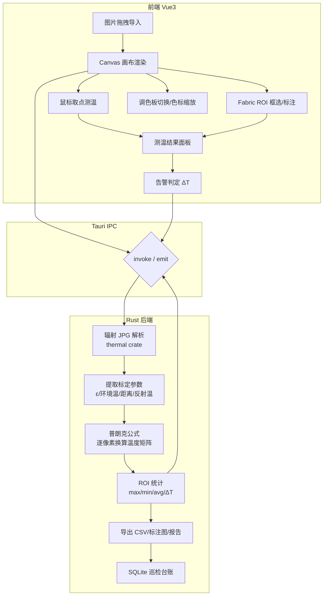
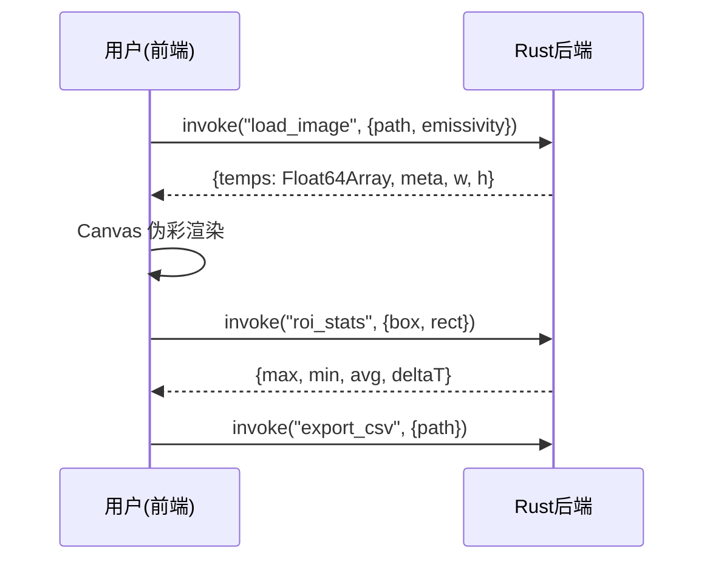

# 红外照片分析工具 · 项目开发文档

| 项目名称 | 红外照片分析工具（IR Inspection Tool） |
| --- | --- |
| 版本 | v0.1（开发文档草稿） |
| 日期 | 2026-10-24 |
| 目标平台 | 统信 UOS20（Debian 10 底层，x86_64），内网离线环境 |
| 应用场景 | 配网无人机（大疆御 3T / Mavic 3T）/ 手持热像仪（FLIR）红外照片分析：测温、ROI 统计、缺陷判断、巡检台账、报告导出 |
| 技术栈 | Tauri 1.x + Rust + Vue3 + Vite + Fabric.js（Canvas） |

---

## 1. 项目概述

### 1.1 背景与痛点

基层供电所 / 配电运维巡检中，无人机（大疆御 3T / Mavic 3T，红外机芯为 FLIR Lepton，640×512）与手持热像仪（FLIR 系列）拍摄的红外照片散落在巡检电脑中，缺少统一分析工具，存在以下痛点：

- 红外照片无法**逐点精确测温**，只能看图估温度，缺陷判断凭经验；
- 变压器、隔离开关、电缆接头测温需要**温差比对（ΔT）**，人工统计慢、易错；
- 巡检记录依赖纸质台账，无法离线沉淀、批量导出报告；
- 商业软件贵、依赖外网授权，**内网离线环境无法使用**。

### 1.2 项目目标

在 **UOS20 内网离线环境**下，提供一款**纯本地、可离线打包分发**的红外照片分析桌面工具：

1. 读取辐射红外图（Radiometric JPG），逐像素换算真实温度；
2. 提供画布交互：鼠标取点测温、ROI 框选统计、调色板切换；
3. 支持发射率修正、温差告警、巡检台账、报告导出；
4. 适配 UOS20，打包 deb 离线安装，**无任何外网依赖**。

### 1.3 名词区分（关键前提）

> ⚠️ **辐射图 vs 普通导出图，必须分清：**
>
> - **辐射图（Radiometric JPG / R-JPEG）**：FLIR、御 3T 保存的原图，内嵌原始 16bit 热数据（DN 值）+ 标定参数（发射率、环境温度、距离、反射温度等），**可逐点精确测温**——这是本工具处理的对象。
> - **普通导出 JPG**：仅调色后的预览图，无原始热数据，**拿不到真实温度**，只能看图，无法分析。

---

## 2. 技术选型

### 2.1 总体选型

| 层次 | 技术 | 说明 |
| --- | --- | --- |
| 桌面框架 | **Tauri 1.x** | 完美适配 UOS20（Debian10），自带 webkit2gtk-4.0，打包 deb 直接 `dpkg -i` 安装，内网最稳 |
| 后端语言 | **Rust** | 直接解析 FLIR/御 3T 辐射 JPG，普朗克公式换算温度，离线独立，无需外挂 exiftool / Python |
| 前端框架 | **Vue3 + Vite** | 轻量、生态成熟，适合 Canvas 渲染场景 |
| 画布绘图 | **Fabric.js** | 便于 ROI 框选、标注、测点标记、拖拽修改，普通 640×512 分辨率流畅 |
| 表格/UI | **Element Plus** | 展示 ROI 测温结果、告警标记、台账表格 |
| 数学计算 | `ndarray` | 温度矩阵批量计算 |
| 热图解析 | `thermal`（crate） | 解析 FLIR 辐射 JPG 原始 DN 值与标定参数 |

### 2.2 为什么不用 Tauri 2.x / Python / WebGL

| 候选方案 | 问题 |
| --- | --- |
| **Tauri 2.x** | 强制依赖 webkit2gtk-4.1 + 更高 glibc，UOS20（Debian10）原生缺库跑不了，需玲珑/AppImage 容器，复杂 |
| **Rust 调 Python**（flyr/flirimageextractor） | 打包 deb 需连带 Python 环境 + numpy，UOS20 离线部署麻烦，不推荐生产 |
| **前端 JS 解析热图** | JS 读二进制 exif、普朗克换算性能差，温度解析必须放 Rust 后端 |
| **WebGL 渲染** | 红外图分辨率低，Fabric.js + Canvas 足够，避免引入复杂度 |

> **决策结论**：`Tauri 1.x + Rust 后端解析 + Vue3 前端 Canvas 渲染`，兼顾 UOS20 兼容性、离线打包、性能与开发效率。

---

## 3. 系统架构



**关键原则**：所有二进制热数据处理、温度换算、矩阵计算均位于 **Rust 后端**；前端仅负责接收温度矩阵并用 Canvas 渲染、交互。文件解析在 Rust 后台异步线程执行，避免 Webview 卡死。

---

## 4. 功能需求

### 4.1 MVP（第一版，交付即用）

| 编号 | 功能 | 说明 |
| --- | --- | --- |
| F1 | 文件导入 | 支持拖拽/批量导入御 3T（Mavic 3T）辐射 JPG（R-JPEG）及 FLIR 辐射 JPG |
| F2 | 画布渲染 | 伪彩渲染温度矩阵，支持缩放到像素级 |
| F3 | 鼠标取温 | 任意位置实时显示温度 ℃ |
| F4 | 调色板切换 | 铁红/彩虹/灰度/白热，支持手动设置温度上下限（色标缩放） |
| F5 | ROI 统计 | 矩形框选：最高温、最低温、平均温、温差 ΔT |
| F6 | 元数据查看 | 发射率 ε、环境温、距离、湿度、拍摄时间、GPS、相机型号 |
| F7 | 发射率修正 | 手动修改 ε，重新换算温度（变压器/瓷瓶/金属端子发射率不同） |
| F8 | 导出 | 带标注红外图、温度矩阵 CSV（便于台账导入 Excel） |
| F9 | 离线打包 | UOS20 打包 deb，`dpkg -i` 直接安装，无外网依赖 |

### 4.2 进阶功能（后续迭代）

| 编号 | 功能 | 说明 |
| --- | --- | --- |
| F10 | 多边形 / 线段测温 | 沿引线温度曲线 |
| F11 | 三相同类设备比对 | A/B/C 相同位置 ΔT 超限自动告警 |
| F12 | 自定义缺陷阈值 | 接头 >70℃、温差 >10℃ 等可配置告警 |
| F13 | MSX 融合画中画 | 可见光 + 红外融合图 |
| F14 | 批量文件夹遍历 | 批量解析、批量导出巡检报告 |
| F15 | 巡检台账 | 绑定杆塔/设备编号，写入本地 SQLite，离线看板 |
| F16 | 报告导出 | 带国网模板的 Word/PDF 巡检缺陷报告 |
| F17 | AI 辅助识别 | ONNX-YOLO 识别设备（绝缘子/端子/刀闸）自动框选测温区域（Rust + ort 本地推理） |

---

## 5. 环境与依赖

### 5.1 开发机（UOS20）依赖安装

```bash
# Tauri 1.x 系统依赖
sudo apt install libwebkit2gtk-4.0-dev build-essential libssl-dev librsvg2-dev

# Rust 工具链
curl --proto '=https' --tlsv1.2 -sSf https://sh.rustup.rs | sh

# 前端
node -v   # 建议 ≥ 18
pnpm install
```

### 5.2 打包依赖（针对 UOS20）

- 依赖写 `libwebkit2gtk-4.0-37`（UOS20 官方源自带），直接 `dpkg -i` 安装；
- 生产 deb 的编译环境建议放在 **Debian10 容器**内进行，避免高版本 glibc 污染产物（否则拷到 UOS20 报 `GLIBC_2.XX not found`）。

### 5.3 内网离线要点

- `cargo` / `pnpm` 依赖需提前在内网镜像缓存（vendor 目录 / 离线 registry）；
- 禁止在 Ubuntu22.04 直接编译 Tauri2 后丢去 UOS20（glibc 不兼容）；
- 系统托盘选 **ayatana**（UOS20 是 ayatana 体系）而非 appindicator。

---

## 6. 项目目录结构

```
ir-inspection-tool/
├── src-tauri/               # Rust 后端（Tauri 主工程）
│   ├── src/
│   │   ├── main.rs          # 入口
│   │   ├── thermal.rs       # 辐射 JPG 解析（thermal crate）
│   │   ├── temperature.rs   # 普朗克公式换算温度矩阵
│   │   ├── roi.rs           # ROI 统计逻辑
│   │   ├── export.rs        # CSV / 标注图 / 报告导出
│   │   └── db.rs            # SQLite 巡检台账
│   ├── tauri.conf.json      # Tauri1 配置（UOS20 适配）
│   └── Cargo.toml
├── src/                     # 前端 Vue3
│   ├── main.js
│   ├── App.vue
│   ├── components/
│   │   ├── CanvasView.vue   # Fabric 画布 + 温度矩阵渲染
│   │   ├── ColorScale.vue   # 色标条
│   │   ├── RoiPanel.vue     # ROI 统计面板
│   │   └── MetaPanel.vue    # 元数据面板
│   └── stores/
├── package.json
├── vite.config.js
└── README.md
```

---

## 7. 核心模块设计

### 7.1 Rust 热图解析（`thermal.rs`）

```rust
use thermal::{flir, ThermalImage};

/// 读取 FLIR 辐射 JPG，返回温度矩阵（℃）与标定参数
pub fn parse_rad_image(path: &str, emissivity: f64) -> Result<ParseResult, Error> {
    let img = ThermalImage::from_path(path)?;
    let thermal = flir::FlirImage::new(img)?;
    let raw = thermal.raw_values();               // 原始 DN / 辐射值
    let params = thermal.parameters();            // ε、环境温、距离、反射温等
    let (w, h) = thermal.dimensions();
    // 逐像素普朗克换算（内部实现），并支持用指定 ε 修正
    let temps = planck_to_celsius(raw, params, emissivity);
    Ok(ParseResult { temps, params, w, h })
}
```

> **御 3T（Mavic 3T）注意**：其红外机芯为 **FLIR Lepton**，辐射照片为 **R-JPEG**，原始热数据与标定参数嵌在 JPEG 的 EXIF / MakerNote 自定义段中，结构与标准 FLIR 热像仪（如 T 系列）略有差异，`thermal` crate 对大疆 R-JPEG 不一定全兼容，需单独适配解析逻辑。
>
> 御 3T 关键参数：红外分辨率 **640×512**、帧率 30Hz、测温范围约 -20℃~+500℃。**必须在相机 App（DJI Fly）中设置「照片格式 = 普通照片 / 保存原图」并开启辐射数据**，否则导出的是调色预览图（无测温数据）。

### 7.2 普朗克温度换算（`temperature.rs`）

```rust
/// R/B/Gain/Offset 反演为辐射值，再用普朗克公式反算温度（℃）
pub fn planck_to_celsius(
    raw: &[u16], params: &ThermalParams, emissivity: f64,
) -> Vec<f64> {
    let planck_r1 = params.planck_r1;   // 出厂标定常量
    let planck_b  = params.planck_b;
    let planck_f  = params.planck_f;
    // 反射温度、大气温度、发射率参与修正
    raw.iter().map(|&dn| {
        let s = planck_r1 / (planck_r1 / dn.exp() + 1.0).ln(); // 示意
        let t_k = planck_b / (planck_f - s).ln();
        t_k - 273.15
    }).collect()
}
```

### 7.3 前端 Canvas 渲染（`CanvasView.vue`）

- Rust 通过 IPC 返回温度矩阵 `Float64Array` 与元数据；
- 前端用 Canvas 依据当前调色板与色标范围将温度映射为 RGBA 伪彩图；
- Fabric.js 叠加 ROI 矩形/多边形、测点标记、温度文字；
- 鼠标移动 → IPC/本地查询对应像素温度 → 实时显示。

### 7.4 IPC 数据流



---

## 8. 开发计划（里程碑）

| 阶段 | 内容 | 验收标准 | 预估 |
| --- | --- | --- | --- |
| M0 | 搭 Tauri1 + Vue3 工程，UOS20 打包配置 | 空壳 deb 可在 UOS20 双击安装运行 | 1-2 天 |
| M1 | Rust 最小 demo：读一张 FLIR 辐射 JPG，输出温度矩阵 + min/max | 能解析真实照片，`thermal` crate 验证通过 | 1-2 天 |
| M2 | 前端 Canvas 接收温度矩阵，伪彩渲染 + 鼠标取温 | 画布显示伪彩图，鼠标显示温度 | 2 天 |
| M3 | Fabric ROI 标注 + 统计面板 | 框选矩形输出 max/min/avg/ΔT | 2 天 |
| M4 | 发射率修正 + 元数据面板 + 调色板/色标 | 修改 ε 温度重算，切调色板生效 | 2 天 |
| M5 | 导出 CSV / 标注图 | 产物可导入 Excel、图片带标注 | 1 天 |
| M6 | 台账 SQLite + 批量处理 + 报告导出 | 批量文件夹遍历、台账离线看板、模板报告 | 3-4 天 |
| M7 | AI 识别（可选） | ONNX-YOLO 本地推理自动框选 | 4-5 天 |

**关键验证点（M1）**：用御 3T 实拍的真实辐射照片先验证 `thermal` crate 能否正常解析大疆 R-JPEG（Lepton 数据段），若不兼容则优先写大疆 R-JPEG 适配（解析 EXIF MakerNote + 热数据段），再继续后续开发。

---

## 9. 打包与分发

### 9.1 deb 打包（UOS20）

```bash
cd src-tauri
# 在 Debian10 容器内执行，避免高 glibc 污染
cargo tauri build --bundles deb
# 产物: src-tauri/target/release/bundle/deb/*.deb
```

### 9.2 离线分发

- 生成的 `.deb` 拷入内网，目标机 `sudo dpkg -i ir-inspection-tool_0.1.0_amd64.deb`；
- 若提示缺 `libwebkit2gtk-4.0-37`，先从 UOS20 官方源离线拉取该包及依赖；
- 不需要玲珑（Tauri1 + deb 是最简单路线）。

---

## 10. 风险与踩坑清单

| # | 风险/坑 | 应对 |
| --- | --- | --- |
| 1 | 御 3T（Lepton）辐射 R-JPEG 与标准 FLIR 数据段结构不同 | M1 阶段优先用真实照片验证，单独解析大疆 EXIF MakerNote + 热数据段适配 |
| 2 | 无人机默认导出调色预览图、无辐射数据 | DJI Fly 中设置保存原图/辐射数据，否则无测温数据可分析 |
| 3 | 高版本 glibc 污染产物，UOS20 报 GLIBC 版本低 | 编译环境固定在 Debian10 容器 |
| 4 | 发射率不准导致测温偏差 | 支持手动改 ε 重算；变压器/瓷瓶/金属端子预设常用 ε |
| 5 | 大文件夹批量处理卡死 Webview | Rust 后台异步线程解析 |
| 6 | Tauri 托盘不显示 | 选 ayatana 插件（UOS20 体系） |
| 7 | 内网拉不到 crates/npm | 提前 vendor 依赖 / 离线 registry 镜像 |

---

## 11. 测试与验收

### 11.1 功能验收（对照第 4 节 F1–F9）

- [x] F1 拖拽/批量导入御 3T（Mavic 3T）辐射 R-JPEG 及 FLIR 辐射 JPG 成功（`dji::tests::parse_m3t_sample` / `parse_dji_official_sample`，两张真实原图）；
- [ ] F2 画布伪彩渲染，缩放不失真（伪彩 LUT 已自动化，画布缩放交互仍需真机验收）；
- [ ] F3 鼠标取温与真实温度偏差在可接受范围（需 CDP/真机验收）；
- [x] F4 调色板切换、色标缩放生效（4 套 LUT 端点与通道、色标 effectiveMin/Max）；
- [x] F5 ROI 框选统计 max/min/avg/ΔT 正确（矩形/多边形/线段单测 + store 统计回填）；
- [ ] F6 元数据显示正确（样本字段解析已断言，面板展示仍需真机验收）；
- [x] F7 修改 ε 后温度矩阵重算（`with_emissivity` 边界与往返、image store 修正链路）；
- [x] F8 CSV 可导入 Excel，标注图完整（UTF-8 BOM、640×512 PNG 可解码、docx 容器头）；
- [ ] F9 在 UOS20 目标机 `dpkg -i` 离线安装并正常启动（本轮未做打包验收）。

### 11.2 兼容性验收

- UOS20（Debian10）原生运行；
- 无外网状态下全功能可用；
- 大批量照片（>100 张）批量处理不卡死、不崩溃。

### 11.3 交付物

- 源码工程（可内网 git 仓库托管）；
- UOS20 deb 安装包；
- 本开发文档 + 用户操作手册（后期补充）。

### 11.4 自动化验收记录（2026-11-04 实测）

复现命令：`pnpm test`（各通道亦可单独执行，详见 README「测试与验收」）。

| 通道 | 结果 |
| --- | --- |
| Rust 后端单测 | 32/32 通过 |
| 前端逻辑单测 | 20/20 通过 |
| 真实样本基线 | 640×512 / 327680 点 / ε=0.95 / 28.96~32.70 ℃ |
| E2E 静态核查 | 19 个注册命令 ↔ 19 个前端封装一致；CDP 因本机无浏览器记为受限项 |

进阶功能的自动化覆盖：F10 多边形/线段统计（`roi::tests`）、F11 三相比对（`diagnosis::tests`）、F12 阈值配置与越界裁剪（`settings::tests`）、F14 批量扫描与错误条目（`batch::tests`）、F15 台账增删改查（`db::tests` / ledger store）、F16 报告导出（`report::tests` / 全链路用例）。

本轮修复的缺陷：铁红调色 `u8` 减法下溢、温差档位断言错误、`count_by_level` 同名遮蔽、测试临时目录未创建/并发冲突、样本缺失静默假绿、温度矩阵 base64 非对齐字节静默截断、缺陷等级字符串索引误映射、调色板兜底分支未取整。

仍未覆盖：F2/F3 画布交互与像素取温、F9 离线打包安装、F13/F17（按计划留待后续）。

---

## 12. 下一步建议

1. **确认核心前提**：先用御 3T 实拍 1–2 张**辐射原图（R-JPEG，640×512）**，用于 M1 阶段验证 `thermal` crate 对大疆 Lepton 数据段的解析兼容性；
2. 优先投入御 3T 大疆 R-JPEG 解析适配（这是最大技术不确定性）；
3. 敲定 UI 风格与配色（贴近国网 / 供电所视觉习惯）；
4. 启动 M0 工程搭建与 UOS20 打包验证。

> 文档版本：v0.1（草稿，随开发迭代更新）
