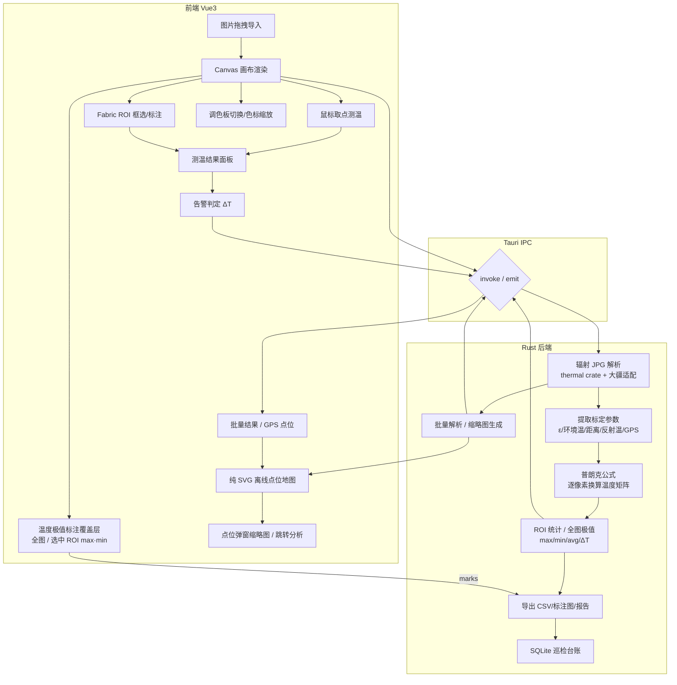

# 红外照片分析工具 · 项目开发文档

| 项目名称 | 红外照片分析工具（IR Inspection Tool） |
| --- | --- |
| 版本 | v0.3（随实现进度更新） |
| 日期 | 2026-11-12（初稿 2026-10-24） |
| 目标平台 | 统信 UOS20（Debian 10 底层，x86_64），内网离线环境 |
| 应用场景 | 配网无人机（大疆御 3T / Mavic 3T）/ 手持热像仪（FLIR）红外照片分析：测温、ROI 统计、缺陷判断、巡检台账、报告导出 |
| 技术栈 | Tauri 1.x + Rust + Vue3 + Vite + Fabric.js（Canvas）+ Pinia + Element Plus |

---

## 1. 项目概述

### 1.1 背景与痛点

基层供电所 / 配电运维巡检中，无人机（大疆御 3T / Mavic 3T，红外机芯为 FLIR Lepton，640×512）与手持热像仪（FLIR 系列）拍摄的红外照片散落在巡检电脑中，缺少统一分析工具，存在以下痛点：

- 红外照片无法**逐点精确测温**，只能看图估温度，缺陷判断凭经验；
- 变压器、隔离开关、电缆接头测温需要**温差比对（ΔT）**，人工统计慢、易错；
- 巡检记录依赖纸质台账，无法离线沉淀、批量导出报告；
- 商业软件贵、依赖外网授权，**内网离线环境无法使用**。

### 1.2 项目目标

在 **UOS20 内网离线环境**下，提供一款**纯本地、可离线打包分发**的红外照片分析桌面工具：

1. 读取辐射红外图（Radiometric JPG），逐像素换算真实温度；
2. 提供画布交互：鼠标取点测温、ROI 框选统计、调色板切换；
3. 支持发射率修正、温差告警、巡检台账、报告导出；
4. 适配 UOS20，打包 deb 离线安装，**无任何外网依赖**。

### 1.3 名词区分（关键前提）

> ⚠️ **辐射图 vs 普通导出图，必须分清：**
>
> - **辐射图（Radiometric JPG / R-JPEG）**：FLIR、御 3T 保存的原图，内嵌原始 16bit 热数据（DN 值）+ 标定参数（发射率、环境温度、距离、反射温度等），**可逐点精确测温**——这是本工具处理的对象。
> - **普通导出 JPG**：仅调色后的预览图，无原始热数据，**拿不到真实温度**，只能看图，无法分析。

---

## 2. 技术选型

### 2.1 总体选型

| 层次 | 技术 | 说明 |
| --- | --- | --- |
| 桌面框架 | **Tauri 1.x** | 完美适配 UOS20（Debian10），自带 webkit2gtk-4.0，打包 deb 直接 `dpkg -i` 安装，内网最稳 |
| 后端语言 | **Rust** | 直接解析 FLIR/御 3T 辐射 JPG，普朗克公式换算温度，离线独立，无需外挂 exiftool / Python |
| 前端框架 | **Vue3 + Vite** | 轻量、生态成熟，适合 Canvas 渲染场景 |
| 画布绘图 | **Fabric.js** | 便于 ROI 框选、标注、测点标记、拖拽修改，普通 640×512 分辨率流畅 |
| 表格/UI | **Element Plus** | 展示 ROI 测温结果、告警标记、台账表格 |
| 状态管理 | **Pinia** | 6 个 store：image / roi / batch / ledger / settings / view |
| 数学计算 | `ndarray`（`thermal` 传递依赖） | 热图解析库的矩阵计算；应用侧温度矩阵以 `Vec<f32>` 为主 |
| 热图解析 | `thermal`（crate） | 解析 FLIR 辐射 JPG 原始 DN 值与标定参数 |
| 元数据 / GPS | `kamadak-exif` + 大疆 XMP 适配 | 读取 EXIF 拍摄时间、机型、GPS，并兼容大疆 XMP 坐标 |
| 图像输出 | `image` | 生成带标注 PNG 与点位弹窗 JPG 缩略图，标注文字用内置点阵字模 |
| 台账 / 报告 | `rusqlite` / `docx-rs` | 本地 SQLite 巡检台账、国网风格 Word 缺陷报告 |
| 交付构建 | **GitHub Actions**（Debian 10 容器） | 在 glibc 2.28 环境产出 UOS20 可安装的 deb / AppImage，本机不维护 Docker 构建链 |

### 2.2 为什么不用 Tauri 2.x / Python / WebGL

| 候选方案 | 问题 |
| --- | --- |
| **Tauri 2.x** | 强制依赖 webkit2gtk-4.1 + 更高 glibc，UOS20（Debian10）原生缺库跑不了，需玲珑/AppImage 容器，复杂 |
| **Rust 调 Python**（flyr/flirimageextractor） | 打包 deb 需连带 Python 环境 + numpy，UOS20 离线部署麻烦，不推荐生产 |
| **前端 JS 解析热图** | JS 读二进制 exif、普朗克换算性能差，温度解析必须放 Rust 后端 |
| **WebGL 渲染** | 红外图分辨率低，Fabric.js + Canvas 足够，避免引入复杂度 |
| **本机直接产出交付包** | 开发机 glibc 高于 UOS20（如 Deepin 25 为 2.38），AppImage 也依赖宿主 glibc，产物无法安装到目标机；交付构建必须放在 Debian 10 级环境 |

> **决策结论**：`Tauri 1.x + Rust 后端解析 + Vue3 前端 Canvas 渲染`，兼顾 UOS20 兼容性、离线打包、性能与开发效率。

---

## 3. 系统架构



**关键原则**：辐射 JPG 的二进制解析、温度换算、矩阵统计、极值扫描与导出文件生成均位于 **Rust 后端**；前端负责用 Canvas 渲染伪彩与交互，并实现零依赖的 GPS 投影、纯 SVG 点位地图绘制、ROI 形状坐标换算与温度极值标注组装（画布覆盖层与 F8 导出共用同一份标注结果）。文件解析在 Rust 后台异步线程执行，避免 Webview 卡死；点位地图无底图、无外网瓦片请求。

---

## 4. 功能需求

### 4.1 MVP（第一版，已实现；F9 目标机安装验收待补）

| 编号 | 功能 | 说明 |
| --- | --- | --- |
| F1 | 文件导入 | 支持拖拽/批量导入御 3T（Mavic 3T）辐射 JPG（R-JPEG）及 FLIR 辐射 JPG |
| F2 | 画布渲染 | 伪彩渲染温度矩阵，支持缩放到像素级 |
| F3 | 鼠标取温 | 任意位置实时显示温度 ℃ |
| F4 | 调色板切换 | 铁红/彩虹/灰度/白热，支持手动设置温度上下限（色标缩放） |
| F5 | ROI 统计 | 矩形框选：最高温、最低温、平均温、温差 ΔT |
| F6 | 元数据查看 | 发射率 ε、环境温、距离、湿度、拍摄时间、GPS、相机型号 |
| F7 | 发射率修正 | 手动修改 ε，重新换算温度（变压器/瓷瓶/金属端子发射率不同） |
| F8 | 导出 | 带 ROI 与温度极值标注的红外图、温度矩阵 CSV（便于台账导入 Excel）；导出标注与画布所见一致 |
| F9 | 离线打包与分发 | 安装包由 GitHub Actions 在 Debian 10 环境构建（glibc 2.28），`dpkg -i` 离线安装、无外网依赖；流水线已就绪，目标机安装验收未完成 |

### 4.2 进阶功能（F10–F12、F14–F16 已实现；F13 / F17 待实现）

| 编号 | 功能 | 说明 |
| --- | --- | --- |
| F10 | 多边形 / 线段测温 | 多边形/线段 ROI 统计；形状可拖动、控制点缩放、框选多选，变换后换算回图像像素坐标并重算统计 |
| F11 | 三相同类设备比对 | A/B/C 相同位置 ΔT 超限自动告警 |
| F12 | 自定义缺陷阈值 | 接头 >70℃、温差 >10℃ 等可配置告警 |
| F13 | MSX 融合画中画 | 可见光 + 红外融合图（待实现） |
| F14 | 批量文件夹遍历 | 批量解析、进度与结果 CSV 导出；按 GPS 在纯 SVG 点位地图展示，点位弹窗按需加载 JPG 缩略图并可跳回图像分析 |
| F15 | 巡检台账 | 绑定杆塔/设备编号，写入本地 SQLite，离线看板 |
| F16 | 报告导出 | 国网风格 Word（.docx）缺陷报告 |
| F17 | AI 辅助识别 | ONNX-YOLO 识别设备（绝缘子/端子/刀闸）自动框选测温区域（Rust + ort 本地推理，待实现） |

---

## 5. 环境与依赖

### 5.1 开发机（Deepin 25 等高 glibc 开发环境）依赖安装

```bash
# Tauri 1.x 系统依赖
sudo apt install libwebkit2gtk-4.0-dev build-essential libssl-dev librsvg2-dev

# Rust 工具链（image 0.25 要求 ≥ 1.88）
curl --proto '=https' --tlsv1.2 -sSf https://sh.rustup.rs | sh

# 前端（Vite 8 要求 Node ^20.19 || >=22.12）
node -v   # 建议 ≥ 20.19
pnpm install
```

### 5.2 交付构建环境（针对 UOS20）

- 依赖写 `libwebkit2gtk-4.0-37`（UOS20 官方源自带），直接 `dpkg -i` 安装；
- 交付构建固定在 **Debian 10（buster，glibc 2.28）** 环境进行，由 GitHub Actions 流水线 `build-uos20.yml` 提供；本机直接编译的产物 glibc 过高，拷到 UOS20 会报 `GLIBC_2.XX not found`；
- 流水线内置 GLIBC 版本断言：产物依赖的最高符号版本超过 2.28 即判定构建失败；
- 工具链：Node 20.19+（Vite 8 要求）、`pnpm@10.24.0`（与 `packageManager` 一致）、Rust 1.90（`image 0.25` 要求 ≥ 1.88）、项目自带的 `@tauri-apps/cli` 1.6.3（Tauri 1.x CLI 的最终发布版，cargo 版也只到 1.6.x）；buster 已 EOL，apt 源切 `archive.debian.org`。

### 5.3 内网离线要点

- 交付构建在 GitHub Actions 联网环境完成（拉取 crates / npm 依赖），产物本身不含任何运行时外网依赖，安装后完全离线可用；
- 内网侧只需下载产物、校验 `SHA256SUMS`，再用 `dpkg -i` 安装；
- 禁止在 Ubuntu22.04 / Deepin 等高 glibc 环境直接编译后丢去 UOS20（glibc 不兼容）；
- 当前版本未启用系统托盘（allowlist 仅开放 dialog 的 open/save）；如后续启用，UOS20 选 **ayatana** 而非 appindicator。

---

## 6. 项目目录结构

```
ir-inspection-tool/
├── src-tauri/               # Rust 后端（Tauri 主工程）
│   ├── src/
│   │   ├── main.rs          # 入口：注册 21 个 Tauri 命令
│   │   ├── lib.rs           # 模块导出（backend-tests 复用同一份源码）
│   │   ├── commands.rs      # command 实现与状态管理
│   │   ├── thermal.rs       # R-JPEG 解析 + EXIF/XMP GPS
│   │   ├── dji.rs           # 御 3T 大疆辐射数据段适配
│   │   ├── temperature.rs   # 普朗克公式换算温度矩阵
│   │   ├── roi.rs           # ROI 掩码统计 + 极值坐标
│   │   ├── diagnosis.rs     # 四级判定 + 三相 ΔT
│   │   ├── export.rs        # CSV / 带标注 PNG
│   │   ├── thumbnail.rs     # 点位弹窗缩略图（data URL）
│   │   ├── batch.rs         # 文件夹批量解析
│   │   ├── db.rs            # SQLite 巡检台账
│   │   ├── report.rs        # docx 缺陷报告
│   │   ├── settings.rs      # 阈值持久化
│   │   ├── utils.rs / error.rs  # 通用函数 / 错误类型
│   │   └── bin/dump_temps.rs    # 真实样本温度矩阵导出
│   ├── backend-tests/       # 无 GTK 依赖的独立测试 crate
│   ├── Cargo.toml / Cargo.lock
│   └── tauri.conf.json      # Tauri1 配置（UOS20 适配）
├── src/                     # 前端 Vue3
│   ├── main.js / App.vue    # 图像分析 / 批量处理 / 巡检台账
│   ├── api/tauri.js         # 21 个 IPC 封装
│   ├── stores/              # 6 个 pinia：image/roi/batch/ledger/settings/view
│   ├── utils/               # palettes/defects/format/mapProjection/roiShape/tempMarks
│   └── components/          # AnalysisView/CanvasView/MapView/ColorScale/
│                            # RoiPanel/MetaPanel/BatchPanel/LedgerPanel/
│                            # ReportDialog/SettingsDialog
├── scripts/                 # run-tests / build-local（本机构建入口）/ check-e2e /
│                            # verify-sample / e2e-cdp 等
├── tests/                   # 6 个前端逻辑测试文件
├── packaging/               # README.md（交付构建与内网安装指引）
├── .github/workflows/       # build-uos20.yml（UOS20 交付构建流水线）
├── e2e/                     # sample.json / mock-app.png
├── package.json
├── vite.config.js
├── README.md
└── 红外照片分析工具项目开发文档.md
```

---

## 7. 核心模块设计

### 7.1 Rust 热图解析（`thermal.rs`）

```rust
use thermal::{flir, ThermalImage};

/// 读取 FLIR 辐射 JPG，返回温度矩阵（℃）与标定参数
pub fn parse_rad_image(path: &str, emissivity: f64) -> Result<ParseResult, Error> {
    let img = ThermalImage::from_path(path)?;
    let thermal = flir::FlirImage::new(img)?;
    let raw = thermal.raw_values();               // 原始 DN / 辐射值
    let params = thermal.parameters();            // ε、环境温、距离、反射温等
    let (w, h) = thermal.dimensions();
    // 逐像素普朗克换算（内部实现），并支持用指定 ε 修正
    let temps = planck_to_celsius(raw, params, emissivity);
    Ok(ParseResult { temps, params, w, h })
}
```

> **御 3T（Mavic 3T）注意**：其红外机芯为 **FLIR Lepton**，辐射照片为 **R-JPEG**，原始热数据与标定参数嵌在 JPEG 的 EXIF / MakerNote 自定义段中，结构与标准 FLIR 热像仪（如 T 系列）略有差异，`thermal` crate 对大疆 R-JPEG 不一定全兼容，需单独适配解析逻辑。
>
> 御 3T 关键参数：红外分辨率 **640×512**、帧率 30Hz、测温范围约 -20℃~+500℃。**必须在相机 App（DJI Fly）中设置「照片格式 = 普通照片 / 保存原图」并开启辐射数据**，否则导出的是调色预览图（无测温数据）。

### 7.2 普朗克温度换算（`temperature.rs`）

```rust
/// R/B/Gain/Offset 反演为辐射值，再用普朗克公式反算温度（℃）
pub fn planck_to_celsius(
    raw: &[u16], params: &ThermalParams, emissivity: f64,
) -> Vec<f64> {
    let planck_r1 = params.planck_r1;   // 出厂标定常量
    let planck_b  = params.planck_b;
    let planck_f  = params.planck_f;
    // 反射温度、大气温度、发射率参与修正
    raw.iter().map(|&dn| {
        let s = planck_r1 / (planck_r1 / dn.exp() + 1.0).ln(); // 示意
        let t_k = planck_b / (planck_f - s).ln();
        t_k - 273.15
    }).collect()
}
```

### 7.3 前端 Canvas 渲染（`CanvasView.vue`）

- Rust 通过 IPC 返回温度矩阵 `Float32Array`（base64 f32 小端）与元数据；
- 前端用 Canvas 依据当前调色板与色标范围将温度映射为 RGBA 伪彩图；
- Fabric.js 叠加 ROI 矩形/多边形/线段、测点标记、温度文字与温度极值标注覆盖层；
- 鼠标移动 → IPC/本地查询对应像素温度 → 实时显示。

### 7.4 IPC 数据流

```mermaid
sequenceDiagram
    participant U as 用户(前端)
    participant R as Rust后端
    U->>R: invoke("load_image", {path, emissivity})
    R-->>U: {temps: Float32Array, meta, w, h}
    U->>U: Canvas 伪彩渲染
    U->>R: invoke("roi_stats", {shape})
    R-->>U: {max, min, avg, deltaT, max_pos, min_pos}
    U->>R: invoke("image_extrema")
    R-->>U: {max, min, max_pos, min_pos}
    U->>R: invoke("get_thumbnail", {path})
    R-->>U: data:image/jpeg;base64,...
    U->>R: invoke("export_csv", {path})
    U->>R: invoke("export_annotated", {path, rois, marks})
```

### 7.5 离线 GPS 点位地图（`MapView.vue` / `mapProjection.js`）

- 批量解析结果中的 EXIF / 大疆 XMP GPS 经 `mapProjection.js` 过滤（非有限值、越界值、(0,0) 占位）后，按等距圆柱投影 + 中心纬度 cos 修正换算为 SVG 坐标；
- 纯 SVG 绘制经纬网格、按缺陷等级着色的点位、缩放/拖拽/适应视图与图例，无底图、无外部瓦片服务；仅展示带有效 GPS 的点位，无坐标项单独计数提示；
- 点位弹窗按需调用 `get_thumbnail` 生成 data URL（仅 `.jpg` / `.jpeg`、单文件 ≤64MB、长边默认 320px，钳制 64~1024），失败时降级占位；点击「跳转分析」经 `view` store 切回图像分析页。

### 7.6 温度极值标注（`tempMarks.js` / `export.rs`）

- 后端 `image_extrema` 返回全图最高/最低温及其像素坐标；ROI 统计同步返回选中 ROI 的极值坐标；
- 前端 `buildTempMarks` 组装最多 4 处标注（全图 max/min + 当前选中 ROI max/min），画布工具栏提供总开关；
- `export_annotated` 接收同一份 `marks`，用内置 5×7 点阵字模绘制 ASCII 标签，保证 F8 导出标注图与画布所见一致，且不依赖系统字体文件。

### 7.7 ROI 形状工具（`roiShape.js`）

- 矩形 / 多边形 / 线段统一序列化为图像像素坐标；
- 拖动、控制点缩放、ActiveSelection 框选多选后按 Fabric 变换矩阵换算回原图坐标并重算统计，避免缩放画布后统计错位。

### 7.8 交付构建与本机构建入口

- **交付构建**：`.github/workflows/build-uos20.yml` 在 `debian:buster` 容器中用项目自带的 `@tauri-apps/cli` 1.6.3 执行 `pnpm tauri build --bundles deb`（Tauri 1.x 的 npm/cargo CLI 均止于 1.6.x），随后断言产物最高 GLIBC 符号版本 ≤ 2.28，再重命名产物并生成 `SHA256SUMS`；AppImage 为可选产物，失败不阻塞 deb；构建失败时把环境版本与日志尾部写入 Job Summary，并把错误行输出为公开可见的 annotation，便于快速定位；
- **本机构建入口**：`scripts/build-local.mjs` 统一 Node ≥ 18 自举、`~/.cargo/bin` 的 PATH 注入与 pnpm 缺失时的 corepack 回退，提供 `env / install / dev / build / test / clean` 子命令；本机产物仅供开发调试，不可交付 UOS20。

---

## 8. 开发计划（里程碑）

| 阶段 | 内容 | 验收标准 | 预估 | 状态 |
| --- | --- | --- | --- | --- |
| M0 | 搭 Tauri1 + Vue3 工程，UOS20 打包配置 | 空壳 deb 可在 UOS20 双击安装运行 | 1-2 天 | 已完成（工程与打包配置；交付构建已迁到 GitHub Actions，目标机安装验收待补） |
| M1 | Rust 最小 demo：读一张 FLIR 辐射 JPG，输出温度矩阵 + min/max | 能解析真实照片，`thermal` crate 验证通过 | 1-2 天 | 已完成（两张真实原图 + 大疆 R-JPEG 适配） |
| M2 | 前端 Canvas 接收温度矩阵，伪彩渲染 + 鼠标取温 | 画布显示伪彩图，鼠标显示温度 | 2 天 | 已完成（画布交互仍需 CDP 真机验收） |
| M3 | Fabric ROI 标注 + 统计面板 | 框选矩形输出 max/min/avg/ΔT | 2 天 | 已完成 |
| M4 | 发射率修正 + 元数据面板 + 调色板/色标 | 修改 ε 温度重算，切调色板生效 | 2 天 | 已完成 |
| M5 | 导出 CSV / 标注图 | 产物可导入 Excel、图片带标注 | 1 天 | 已完成（新增温度极值标注同源导出） |
| M6 | 台账 SQLite + 批量处理 + 报告导出 | 批量文件夹遍历、台账离线看板、模板报告 | 3-4 天 | 已完成（新增离线 GPS 点位地图与缩略图） |
| M7 | AI 识别（可选） | ONNX-YOLO 本地推理自动框选 | 4-5 天 | 未实施（F17 留待后续） |

**关键验证点（M1，已完成）**：两张御 3T 真实辐射原图已通过 `dji::tests` 解析用例；`thermal` crate 对大疆 Lepton 数据段的差异由 `dji.rs` 单独适配（EXIF MakerNote / XMP GPS + 热数据段），该风险已闭环。

---

## 9. 打包与分发

### 9.1 交付构建（GitHub Actions）

交付包统一由 `.github/workflows/build-uos20.yml` 在 Debian 10（buster）容器中构建：

```bash
# 触发方式
# - Actions 页手动运行 build-uos20
# - push 到 main 做构建校验
# - 推送 v* 标签（如 v0.1.0）额外发布 GitHub Release
```

流水线要点：buster 已 EOL，apt 源切 `archive.debian.org`；Node 20.19+、`pnpm@10.24.0`、Rust 1.90、项目自带的 `@tauri-apps/cli` 1.6.3；`pnpm install --frozen-lockfile` 后执行 `pnpm tauri build --bundles deb`；随后把 `DEBIAN/control` 的 `Package` 字段规范化为 ASCII `ir-inspection-tool`（中文 `productName` 会被 dpkg 拒绝安装）并断言包名合法；再断言产物最高 GLIBC 符号版本 ≤ 2.28；AppImage 为可选产物（linuxdeploy 在容器内不可用时跳过，不阻塞 deb）；失败时把环境版本与日志尾部写入 Job Summary，并把错误行输出为 annotation。

产物：deb（必需）、AppImage（可选）、`SHA256SUMS`，文件名统一为 ASCII（`ir-inspection-tool_<版本>_amd64.*`），避免中文 `productName` 带来的文件名问题。

### 9.2 离线分发

- 在联网侧从 GitHub 下载产物并拷贝进内网，`sha256sum -c SHA256SUMS` 校验；
- UOS20 内网机执行 `sudo dpkg -i ir-inspection-tool_0.1.0_amd64.deb`；缺 `libwebkit2gtk-4.0-37` 时先从 UOS20 官方源离线拉取该包及依赖；
- AppImage 方式：`chmod +x` 后直接运行；
- 不需要玲珑（Tauri1 + deb 是最简单路线）；
- 本机（高 glibc 开发环境）只做开发与调试构建，不产出交付包。

---

## 10. 风险与踩坑清单

| # | 风险/坑 | 应对 |
| --- | --- | --- |
| 1 | 御 3T（Lepton）辐射 R-JPEG 与标准 FLIR 数据段结构不同 | 已由 `dji.rs` 单独解析大疆 EXIF/XMP + 热数据段，并用两张真实原图回归 |
| 2 | 无人机默认导出调色预览图、无辐射数据 | DJI Fly 中设置保存原图/辐射数据，否则无测温数据可分析 |
| 3 | 高版本 glibc 污染产物，UOS20 报 GLIBC 版本低 | 交付构建固定在 GitHub Actions 的 Debian 10 容器，流水线内置 GLIBC ≤ 2.28 断言 |
| 4 | 发射率不准导致测温偏差 | 支持手动改 ε 重算；变压器/瓷瓶/金属端子预设常用 ε |
| 5 | 大文件夹批量处理卡死 Webview | Rust 后台异步线程解析；当前为顺序执行，可按需引入 rayon 并行 |
| 6 | 系统托盘不显示 | 当前版本未启用系统托盘；如后续启用，UOS20 选 ayatana 插件 |
| 7 | 内网拉不到 crates/npm | 交付构建在 GitHub Actions 联网环境完成；内网只下载产物并校验 `SHA256SUMS` |
| 8 | Debian 10 已 EOL，apt 源 404 | 流水线把 apt 源切到 `archive.debian.org` 并关闭有效期校验 |
| 9 | Node 版本过低导致前端构建失败 | Vite 8 要求 Node `^20.19 \|\| >=22.12`，流水线固定安装 Node 20.19+，不依赖系统 apt 的 Node |
| 10 | 构建容器内缺 `libxdo-dev` 导致 wry/tao 的 dox feature 链接失败 | CI 的 apt 依赖清单固定包含 `libxdo-dev`；失败时通过 annotation 直接给出错误行 |
| 11 | 中文 `productName` 写进 `DEBIAN/control` 的 `Package` 字段，dpkg 报 invalid package name | CI 打包后把该字段规范化为 `ir-inspection-tool` 并断言合法；中文窗口标题保持不变 |

---

## 11. 测试与验收

### 11.1 功能验收（对照第 4 节 F1–F16 及新增能力）

- [x] F1 拖拽/批量导入御 3T（Mavic 3T）辐射 R-JPEG 及 FLIR 辐射 JPG 成功（`dji::tests::parse_m3t_sample` / `parse_dji_official_sample`，两张真实原图）；
- [ ] F2 画布伪彩渲染，缩放不失真（伪彩 LUT 已自动化，画布缩放交互仍需真机验收）；
- [ ] F3 鼠标取温与真实温度偏差在可接受范围（需 CDP/真机验收）；
- [x] F4 调色板切换、色标缩放生效（4 套 LUT 端点与通道、色标 effectiveMin/Max）；
- [x] F5 ROI 框选统计 max/min/avg/ΔT 正确（矩形/多边形/线段单测 + store 统计回填）；
- [ ] F6 元数据显示正确（样本字段解析已断言，面板展示仍需真机验收）；
- [x] F7 修改 ε 后温度矩阵重算（`with_emissivity` 边界与往返、image store 修正链路）；
- [x] F8 CSV 可导入 Excel，标注图完整（UTF-8 BOM、640×512 PNG 可解码、docx 容器头）；
- [ ] F9 GitHub Actions 产出的 deb 在 UOS20 目标机 `dpkg -i` 离线安装并正常启动（流水线已就绪，尚未产出产物并在目标机验收）；
- [x] F10 多边形/线段 ROI 统计与形状拖动/缩放/多选（`roi::tests` / `roiShape.test.js`）；
- [x] F11 三相同部位 ΔT 比对告警（`diagnosis::tests` / `stores.test.js`）；
- [x] F12 缺陷阈值配置与越界裁剪（`settings::tests` / settings store）；
- [x] F14 批量扫描、进度与错误条目、结果 CSV（`batch::tests` / batch store）；
- [x] F15 台账增删改查与等级统计（`db::tests` / ledger store）；
- [x] F16 国网风格 Word 报告生成（`report::tests` / 全链路用例）；
- [x] 离线 GPS 点位地图：坐标过滤与投影、缩放/适应视图、无 GPS 提示（`mapProjection.test.js`）；
- [x] 点位缩略图：JPG 限制、64MB 上限、长边钳制、真实 R-JPEG 可解码（`thumbnail::tests`）；
- [x] 温度极值标注：全图 + 选中 ROI 最多 4 处、导出与画布同源（`tempMarks.test.js` / `export::tests`）；
- [x] ROI 形状复用：变换矩阵换算回图像坐标（`roiShape.test.js`）。

### 11.2 兼容性验收

- UOS20（Debian10）原生运行；
- 无外网状态下全功能可用；
- 大批量照片（>100 张）批量处理不卡死、不崩溃。

### 11.3 交付物

- 源码工程（可内网 git 仓库托管）；
- UOS20 deb 安装包（由 GitHub Actions 产出后拷入内网）；
- 本开发文档 + 用户操作手册（后期补充）。

### 11.4 自动化验收记录（2026-11-04 实测，历史基线）

复现命令：`pnpm test`（各通道亦可单独执行，详见 README「测试与验收」）。

| 通道 | 结果 |
| --- | --- |
| Rust 后端单测 | 32/32 通过 |
| 前端逻辑单测 | 20/20 通过 |
| 真实样本基线 | 640×512 / 327680 点 / ε=0.95 / 28.96~32.70 ℃ |
| E2E 静态核查 | 19 个注册命令 ↔ 19 个前端封装一致；CDP 因本机无浏览器记为受限项 |

进阶功能的自动化覆盖：F10 多边形/线段统计（`roi::tests`）、F11 三相比对（`diagnosis::tests`）、F12 阈值配置与越界裁剪（`settings::tests`）、F14 批量扫描与错误条目（`batch::tests`）、F15 台账增删改查（`db::tests` / ledger store）、F16 报告导出（`report::tests` / 全链路用例）。

本轮修复的缺陷：铁红调色 `u8` 减法下溢、温差档位断言错误、`count_by_level` 同名遮蔽、测试临时目录未创建/并发冲突、样本缺失静默假绿、温度矩阵 base64 非对齐字节静默截断、缺陷等级字符串索引误映射、调色板兜底分支未取整。

仍未覆盖：F2/F3 画布交互与像素取温、F9 离线打包安装、F13/F17（按计划留待后续）。

### 11.5 当前实现与验收基线（2026-11-11 复核）

实现状态：F1–F8、F10–F12、F14–F16 已落地；F9 交付构建已迁到 GitHub Actions（`build-uos20.yml`），目标机安装验收待补；F13/F17 未实施。本轮在 F8 与 F14 基础上增补：离线 GPS 点位地图（纯 SVG、等距圆柱投影）、按需 JPG 缩略图、画布温度极值标注总开关与同源导出、ROI 形状工具。

复现命令：`pnpm test`（未安装 pnpm 时可用 `node scripts/run-tests.mjs` 等价执行）。

| 通道 | 本次复核结果 |
| --- | --- |
| Rust 后端单测 | 50/50 通过（含缩略图、极值坐标、带标注 PNG、真实样本全链路） |
| 前端逻辑单测 | 45/45 通过（6 个测试文件，含 GPS 投影 / ROI 形状 / 温度标注 / 视图跳转） |
| 真实样本基线 | 640×512 / 327680 点 / ε=0.95 / 28.96~32.70 ℃ |
| E2E 静态核查 | 21 个注册命令 ↔ 21 个前端封装，9 个 mock 分支；CDP 仍为环境受限项 |

新增依赖 `image` / `kamadak-exif` 已写入 `Cargo.lock`；交付构建由 CI 联网拉取依赖，产物安装后完全离线可用。仍未覆盖：F2/F3 画布交互与像素取温的 CDP 真机验收、F9 目标机离线安装、F13/F17。

---

## 12. 下一步建议

1. **跑通交付构建并补齐 F9 验收**：在 GitHub Actions 触发 `build-uos20`，确认 deb 构建与 GLIBC 断言通过，下载 deb 与 `SHA256SUMS` 拷入 UOS20 内网机执行 `dpkg -i`，验证启动与全功能可用；
2. **补 CDP 图形验收**：在有 Chrome/Chromium 的机器设置 `CHROME_PATH`，先 `pnpm dev` 再运行 `node scripts/e2e-cdp.mjs`，覆盖 F2 画布缩放、F3 悬停取温、F6 元数据面板；
3. **按实际巡检数据回归**：用多批次真实照片验证 GPS 点位地图、无坐标项提示与缩略图失败降级路径；
4. **后续评估 F13 / F17**：MSX 融合与 ONNX-YOLO 本地推理自动框选，按计划留待后续迭代。

> 文档版本：v0.3（随实现进度更新；初稿 v0.1，2026-10-24）
